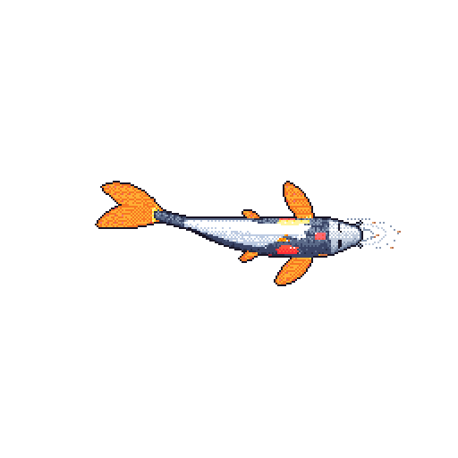

# Tuba Khan

 

 

---

<table>
<tr>
<td valign="top">

### About

- 🔭 Computer vision & full-stack developer
- 🧠 Exploring AI, robotics & motion tracking
- ✍️ Writing at [my blog](https://tubakhan.art.blog/)
- 📫 tubak2907@gmail.com

</td>
<td align="center" valign="middle" width="280">
  
   
  <b>🐟 Tuba's fish</b> redrawn every night from my GitHub activity
</td>
</tr>
</table>

---

### Stack

  

### Activity

  

 

<b>Tuba Khan</b> · tubakhxn · Made with ☕ and a lot of commits

  

